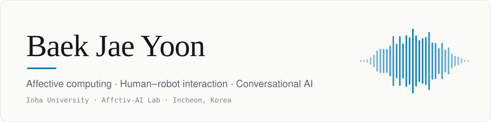
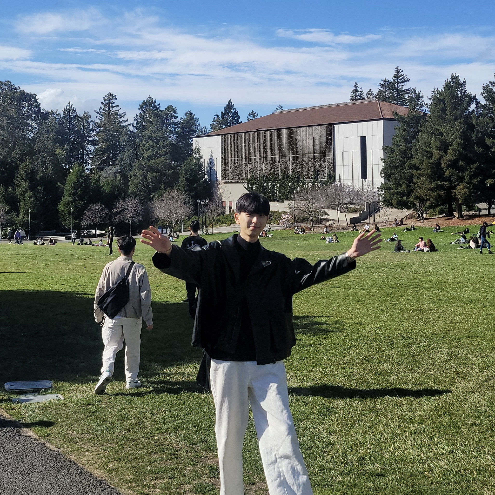
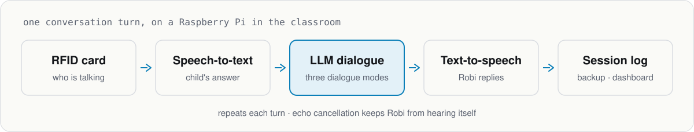

<picture>
  <source media="(prefers-color-scheme: dark)" srcset="assets/header-dark.svg" />
  
</picture>

**M.S. Student in Artificial Intelligence, Inha University · <a href="https://affective.netlify.app/">Affctiv-AI Lab</a>**

Building AI that understands human emotion and talks with people.

 

I'm a master's student at Inha University's [Affctiv-AI Lab](https://affective.netlify.app/), building conversational robots that read and respond to children's emotions. Before research, I spent years starting things: startup clubs, accelerator programs, and a web service I ran as PM with an eleven-person team. I still like taking an idea all the way from plan to build to launch.

## Education

| Period | Degree |
|---|---|
| Aug 2026 – present | **M.S.**, Electrical and Computer Engineering (Artificial Intelligence), Inha University · [Affctiv-AI Lab](https://affective.netlify.app/) |
| – Aug 2026 | **B.S.**, Electrical and Electronic Engineering, Inha University |

## Research

### Robi: An Affective Conversational Robot for Kindergartens [Affctiv-AI Lab](https://affective.netlify.app/) · 2026 –

<picture>
  <source media="(prefers-color-scheme: dark)" srcset="assets/robi-pipeline-dark.svg" />
  
</picture>

A voice-based robot installed in kindergartens that talks with young children to **build rapport, support emotional development, and assess (classify)** their responses.

- Three dialogue modes (rapport / enhancement / classification) with week-by-week prompt design
- Personalized interaction: identifies each child with an RFID card and greets them by name
- Raspberry Pi voice pipeline (STT · TTS · LLM · echo cancellation) with automated pre-session hardware checks
- Automatic session backup and an experiment-monitoring dashboard

※ Private lab repository

## Awards

| Year | Award |
|---|---|
| 2022 | **Grand Prize (University President's Award)**, i-Startup Lab Startup Accelerating |
| 2021 | **Grand Prize (University President's Award)**, i-Startup Lab Startup Accelerating |
| 2021 | **Excellence Award (2nd Place)**, i-Startup Lab Super Challenge Makerthon |

## Activities & Leadership

| Year | Activity |
|---|---|
| Present | **Mensa Korea**: Puzzle Committee member, Social Contribution Committee member |
| 2024 – 2025 | **Web Service Launch & Operation**: PM leading a team of 11 (4 frontend, 5 backend, 2 designers); owned service planning, wireframes, web development and marketing strategy and execution |
| 2023 | **Univ. Makeus Challenge (Inha, 3rd)**: iOS Part Lead (organizing team) |
| 2023 | Completed **NEXT CHALLENGE FIS** (Future Innovation School), 1st cohort |
| 2022 | **Inha Venture Club** (startup club, Inha Startup Support Foundation): Vice President, 26th |
| 2021 | **INCOM** (Inha University central computer club): General Affairs Officer, 41st |

## Tools

**Languages & Web** 

**Conversational AI** 

**Embedded Systems** 

**3D Design & XR** 

**Growth & Data** 

<b>More on each skill</b>

- **3D Modeling (Inventor / Fusion 360)**: designs parts and drawings for projects; has taught the basics to high school and university students
- **Embedded Systems (Arduino, Raspberry Pi)**: builds circuits and combines them with 3D printing in projects such as an IoT smart home, a quadruped robot and a fingerprint safe; runs the Raspberry Pi voice pipeline of the Robi robot; teaching experience
- **3D Printing / Laser Cutting**: configures slicers (Cura, Sindoh) and G-code; uses laser cutting in projects
- **C / C++**: algorithm problem solving, object-oriented programming, Data Structures coursework
- **Python**: conversational AI robot development, algorithm problem solving, Excel automation
- **Unity**: AR · VR · MR development
- **GA4 / GTM**: collects and analyzes user acquisition, clicks, scroll depth and other behavior to improve AARRR metrics

## Keywords

`Leadership` `Focus` `Positive Influence` `Drive` `Responsibility` `ENTJ`
